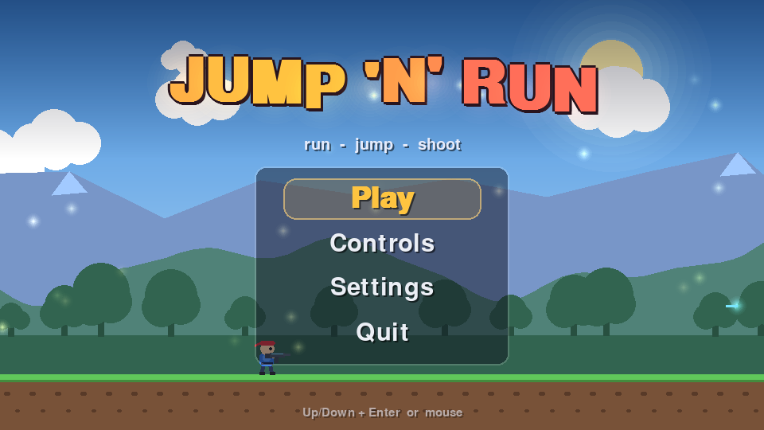
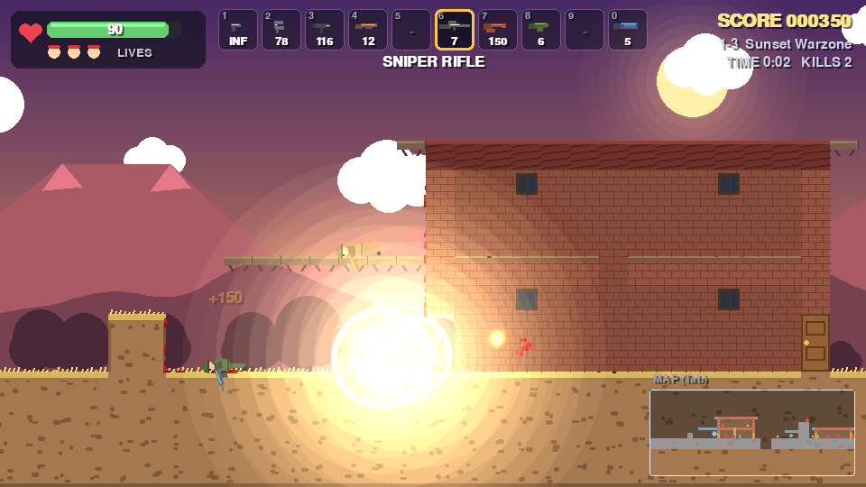
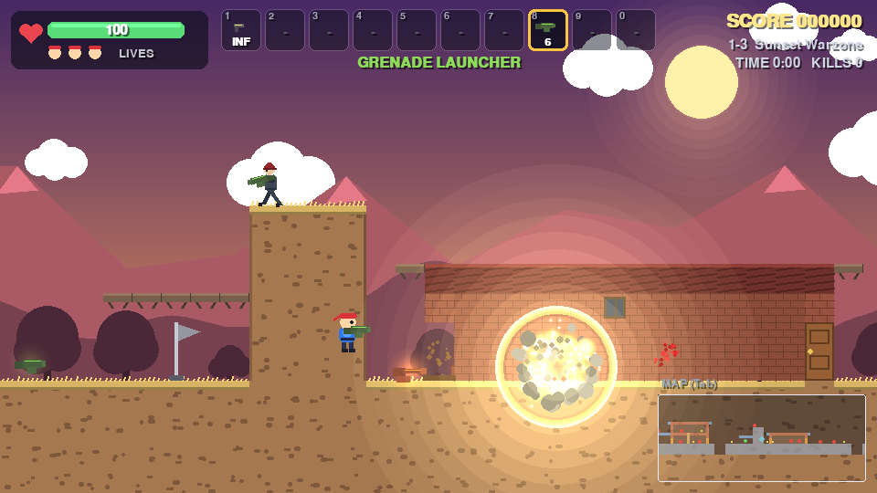
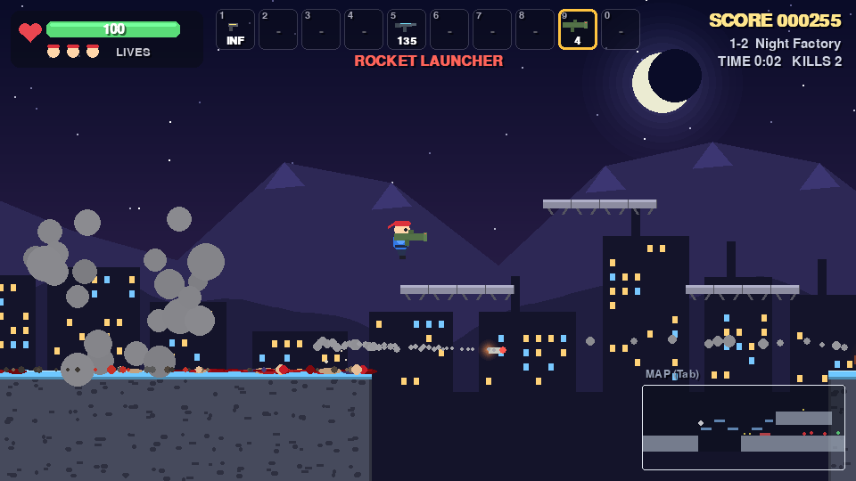
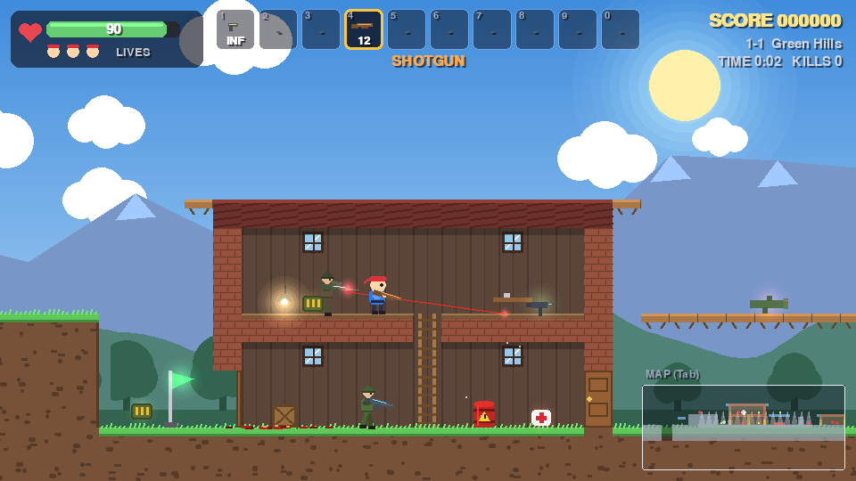

# Jump 'n' Run – a 2D platformer in Pygame

A complete side-scrolling run-and-gun platformer written in Python with
**pygame**. Run, jump across platforms, pick up weapons, shoot or stomp
enemies and reach the flag at the end of each level.

All physics are **hand-written** – no physics library is used. Movement runs
on a fixed timestep with exact constant-acceleration integration and
axis-separated collision against the tile map (see
[`game/physics.py`](game/physics.py)). All graphics are drawn with pygame
primitives, so there are no image assets.











## Features

* **Tight platformer movement**: acceleration and friction, gravity with a
  stronger fall, variable jump height (release early for a short hop),
  coyote time, jump buffering, squash & stretch.
* **Own physics**: fixed timestep (1/120 s), exact integration for constant
  acceleration, tile collisions resolved per axis, no tunnelling. Particles,
  casings, debris, gibs, grenades and corpses all use the same tile world.
* **Three tile-based levels** written as ASCII maps ([`game/levels.py`](game/levels.py)):
  *Green Hills* (day), *Night Factory* (night) and *Sunset Warzone* (dense
  fights, bunkers and barrel fields). Solid blocks, one-way platforms you can
  jump through (and drop through), spikes, pits, checkpoints and a goal flag.
* **Enterable houses and bunkers** (Terraria style) in every level: back
  walls, windows, doors that open when you walk into them or press `E`,
  several floors connected by climbable ladders, furniture (tables, crates,
  lamps), soldiers and loot inside. The facade fades out while you are inside.
  Closed doors block bullets and line of sight; explosions blow them open;
  enemies never open doors.
* **Minimap**: a semi-transparent map in the bottom-right corner with tiles,
  houses, you, enemies (red), pickups (yellow), checkpoints (green) and the
  goal (gold). Toggle with `Tab` / `N` or in the settings.
* **Ten weapons** with ammo, switching and a HUD (see the table below).
* **Nine soldier types** drawn as animated figures (head, helmet, torso,
  arms, legs) with a walk cycle, an arm that aims the gun at you, a uniform
  colour per type and a health bar once they are hurt.
* **Explosive barrels** that chain-react, big explosions with a shockwave
  ring, fire, smoke and bouncing debris, strong screen shake, hit-stop on
  kills, and bullet casings ejecting from every gun.
* **Blood** (can be switched off): drops spray in the hit direction, fall
  with gravity and leave splatter decals on floors, walls and ceilings;
  explosion kills burst into gibs; other kills leave ragdoll-style corpses
  that fly back, tumble and come to rest.
* **Procedural sound**: every sound effect and the background music loop are
  synthesised with numpy at startup – no audio files.
* **Health, lives, checkpoints, respawn**, health packs and ammo crates,
  score, kills and level timer.
* **Menus**: animated start menu (Play, Controls, Settings, Quit), settings
  screen, pause menu on `Esc` (Resume, Restart Level, Main Menu), game over /
  victory screens and fade transitions.

## Weapons

| Key | Weapon | Ammo per pickup (max) | Map char | Notes |
|-----|--------|-----------------------|----------|-------|
| 1 | Pistol | infinite | – | accurate starting weapon |
| 2 | Dual Pistols | 80 (160) | `D` | alternates two guns, fast |
| 3 | SMG | 120 (240) | `U` | very fast, wide spread |
| 4 | Shotgun | 12 (24) | `S` | 6 pellets, short range, big knockback |
| 5 | Machine Gun | 90 (180) | `M` | fast and fairly accurate |
| 6 | Sniper Rifle | 10 (20) | `N` | 120 damage, pierces up to 4 enemies |
| 7 | Flamethrower | 150 (300) | `F` | flames pass through enemies and set them on fire |
| 8 | Grenade Launcher | 6 (12) | `L` | bouncing grenades, 1.6 s fuse or explode on contact |
| 9 | Rocket Launcher | 5 (10) | `R` | accelerating rocket, area damage, rocket jumps |
| 0 | Railgun | 5 (10) | `Z` | instant beam that pierces every enemy up to a wall |

When a weapon runs dry you automatically switch back to the pistol. Your own
explosives push you around but never hurt you; enemy grenades and barrels do.

## Enemies

Every enemy is a soldier. Speed is the patrol speed in pixels per second
(the player runs at 260), fire rate is the pause between two attacks, range
is how far away they spot and shoot you (in pixels; one tile is 32).

| Map char | Soldier | Uniform | HP | Speed | Weapon | Damage | Fire rate | Range | Notes |
|---|---|---|---|---|---|---|---|---|---|
| `e` | Recruit | olive | 40 | 50 | pistol | 8 | 1 shot / 1.8 s | 380 | weak, slow reactions |
| `r` | Rifleman | green | 60 | 60 | rifle | 9 × 3 | 3-round burst / 1.6 s | 460 | |
| `k` | Shotgunner | brown | 80 | 60 | shotgun | 8 × 5 pellets | 1 blast / 1.7 s | 300 | close range |
| `g` | Grenadier | slate blue | 70 | 60 | grenade launcher | 40 splash (r 80) | 1 grenade / 2.2 s | 520 | lobs bouncing grenades in an arc |
| `n` | Sniper | khaki | 50 | 25 | sniper rifle | 35 | 1 shot / 2.6 s | 800 | aims for 1 s with a red laser sight, 1400 px/s bullets |
| `h` | Heavy | grey | 240 | 30 | minigun | 6 × 18 | 18-round spray / 2.0 s | 480 | spins up first, hard to knock back |
| `o` | Officer (elite) | black / red beret | 100 | 110 | SMG | 10 × 5 | 5-round burst / 1.1 s | 440 | fast, keeps his distance, jumps over your bullets |
| `q` | Rocketeer | red | 90 | 40 | rocket launcher | 45, splash (r 80) | 1 rocket / 3.0 s | 600 | slow accelerating rockets |
| `s` | Guard | purple | 70 | 0 | pistol | 12 | 1 shot / 1.5 s | 460 | stationary |
| `b` | Explosive barrel | | | | | 110 splash (r 120) | | | explodes when shot, chains into nearby barrels |

Jump on any soldier's head to stomp it.

## Controls

| Action | Keys |
|--------|------|
| Move | `A` / `D` or `←` / `→` |
| Jump (hold for a higher jump) | `Space`, `W` or `↑` |
| Drop through a one-way platform | `S` / `↓` + Jump |
| Climb ladders | `W` / `S` or `↑` / `↓` (Jump lets go) |
| Open / close a door | `E` (or just walk into it) |
| Toggle the minimap | `Tab` or `N` |
| Shoot | Left mouse button, `J` or `F` |
| Aim | Mouse (without mouse movement you shoot in the facing direction) |
| Next weapon | `Q` or mouse wheel |
| Select weapon | `1` – `9`, `0` |
| Mute / unmute | `M` (works everywhere) |
| Pause menu | `Esc` |
| Menus | `↑` / `↓` + `Enter`, or the mouse |

## Settings

Open **Settings** from the main menu:

| Setting | Default | How |
|---------|---------|-----|
| Master volume | 80 % | `←` / `→` (or `Enter` to step up) |
| Sound effects | On | `Enter` toggles |
| Music | On | `Enter` toggles |
| Blood | On | `Enter` toggles; off replaces blood, gibs and splatter with sparks |
| Minimap | On | `Enter` toggles (also `Tab` / `N` in game) |

Settings apply immediately and last until you quit the game.

## Sound

All audio is generated in [`game/audio.py`](game/audio.py) with numpy when
the game starts (about 0.1 s): filtered noise bursts and pitch sweeps for
each of the ten weapons, the empty click and reload, jump, landing,
footsteps, pickups, enemy hits and deaths, player hurt and death,
explosions, grenade bounces, checkpoints, the level-complete fanfare and menu
hover/select blips. The music is a seamless 4-bar loop (bass, arpeggio, kick,
snare, hi-hats) at 124 BPM.

The sound buffers are built to match whatever format the mixer actually
opened (sample rate, 8/16-bit integer or 32-bit float, mono or stereo), and
each buffer is checked to be non-silent. If there is no audio device, or
numpy or the mixer is unavailable, the game still runs and prints a warning
starting with `[jump-n-run audio]` to the console that explains why.

### No sound? Run the audio test

```bash
python main.py --audio-test
```

It prints the pygame/SDL/numpy versions and the mixer format, then plays a
440 Hz test beep, three effects and a few seconds of music. If it reports
`enabled=False`, the printed reason tells you what failed (most often a
missing `numpy` – run `pip install -r requirements.txt` inside the activated
virtual environment). If it reports `enabled=True` but you hear nothing,
check the system volume and output device, and make sure sound is not muted
in the game (`M`, or Settings).

## Setup and running

### Requirements

* **Python 3.9 – 3.13** (64-bit recommended). The game depends on
  [pygame 2.6](https://pypi.org/project/pygame/), which only ships prebuilt
  wheels up to Python 3.13. On newer Python versions pip would try to build
  pygame from source, which usually fails, so stick to 3.9 – 3.13.
* Check your version with `python --version` (on macOS/Linux it may be
  `python3 --version`).

### 1. Create a virtual environment

Run this in the project folder (the one containing `main.py`):

```bash
python -m venv .venv
```

On macOS/Linux use `python3` if `python` is not available. The `.venv` folder
is listed in `.gitignore` and is never committed.

### 2. Activate it

| System | Command |
|--------|---------|
| Windows – PowerShell | `.venv\Scripts\Activate.ps1` |
| Windows – cmd | `.venv\Scripts\activate.bat` |
| macOS / Linux (bash, zsh) | `source .venv/bin/activate` |

When the environment is active, your prompt starts with `(.venv)`.

> **PowerShell note:** if activation fails with "running scripts is disabled
> on this system", allow local scripts for your user once and try again:
> `Set-ExecutionPolicy -Scope CurrentUser -ExecutionPolicy RemoteSigned`

### 3. Install the dependencies

```bash
pip install -r requirements.txt
```

This installs `pygame`, `numpy` (for the procedural sound) and `pytest` into the virtual environment only.

### 4. Play

```bash
python main.py
```

### 5. Run the tests

```bash
python -m pytest
```

The tests run headless (no window opens).

### 6. Deactivate the environment

```bash
deactivate
```

Next time, just activate the environment again (step 2) and run
`python main.py`; there is no need to reinstall.

## How the physics work

* The simulation advances in fixed steps of `1/120 s`
  (`FIXED_DT` in [`game/constants.py`](game/constants.py)). The frame loop
  accumulates real time and runs as many steps as needed, so the game feels
  the same at any frame rate.
* Each step applies a constant acceleration `a` (gravity, run acceleration
  or friction) and updates
  `v' = v + a·dt` and `x' = x + (v + v')/2 · dt`, which is exact for
  constant acceleration (the same as velocity Verlet in that case). A full
  jump therefore reaches exactly `JUMP_HEIGHT`.
* Collisions: the body moves along X, gets pushed out of solid tiles, then
  moves along Y and is pushed out again. Speeds are clamped so a body never
  moves more than one tile per step, which means only the tiles at the
  leading edge need checking. One-way platforms only block bodies whose
  feet were above the platform before the move.
* Projectiles sub-step their motion (quarter-tile steps) so even fast bullets
  cannot pass through walls.

## Make your own level

Levels are ASCII maps in [`game/levels.py`](game/levels.py):

| Char | Meaning | Char | Meaning |
|------|---------|------|---------|
| `#` | solid block | `=` | one-way platform |
| `^` | spikes | `P` | player start |
| `G` | goal flag | `C` | checkpoint |
| `+` | health pack | `a` | ammo crate |
| `b` | explosive barrel | `:` | back wall (house interior) |
| `O` | window (back wall with glass) | `\|` | door (a vertical run is one door) |
| `H` | ladder (the top rung can be stood on) | `t` `x` `l` | table, crate, lamp (decoration) |

Enemy and weapon characters are listed in the tables above. Entities and
decorations placed next to back-wall tiles automatically get a back wall
behind them, and every connected back-wall area becomes one house whose
facade fades when you walk in. `add_house()` in `game/levels.py` stamps a
complete house (walls, roof, doors, floors, ladder, windows, contents) into
a map:

```python
add_house(rows, x0=101, width=14, ground=15, floors=2,
          contents={(4, 0): "r", (11, 0): "+", (5, 1): "n"}, ladder=7, windows=(3, 10))
```

Add a new `LevelDef` to `LEVELS` and it is played after the existing ones.

## Project structure

```
jump-n-run/
├── main.py              # entry point: python main.py
├── requirements.txt
├── game/
│   ├── app.py           # window, main loop, scene switching with fades
│   ├── menu.py          # animated start menu, controls and settings screens
│   ├── game.py          # in-game scene: input, fixed timestep, pause/game over overlays
│   ├── world.py         # game rules: player, enemies, barrels, projectiles, explosions, blood, pickups
│   ├── audio.py         # procedural sound effects and music (numpy), silent fallback
│   ├── settings.py      # volume, sound, music and blood settings
│   ├── player.py        # player movement (coyote time, jump buffer, variable jump) and inventory
│   ├── physics.py       # hand-written integration and tile collision
│   ├── weapons.py       # weapon specs, projectiles, pickups
│   ├── enemies.py       # nine soldier types, barrels, corpses
│   ├── level.py         # ASCII level parser, tile queries, houses, doors, ladders
│   ├── levels.py        # the level maps and colour themes
│   ├── camera.py        # smooth follow camera
│   ├── effects.py       # particles, blood and decals, shockwaves, beams, screen shake
│   ├── render.py        # all drawing: parallax, tiles, houses, characters, HUD, minimap
│   ├── ui.py            # fonts, panels, animated menu list
│   └── constants.py     # tuning values
├── tests/               # pytest suite: physics, weapons, arsenal, enemies, soldiers, houses (doors,
│                        # ladders, back walls), minimap, action, world, audio, menus, smoke test
├── tools/
│   └── make_screenshots.py  # renders the screenshots in docs/ headless
└── docs/                # screenshots
```
